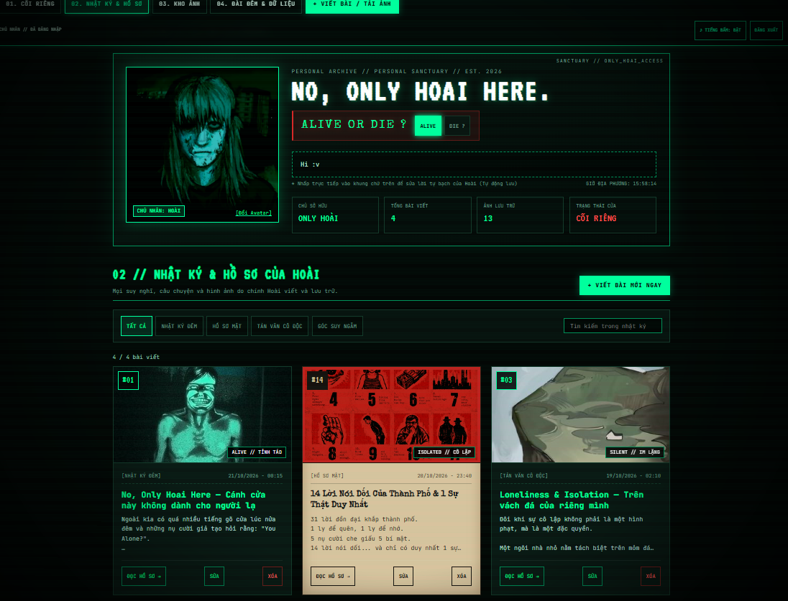
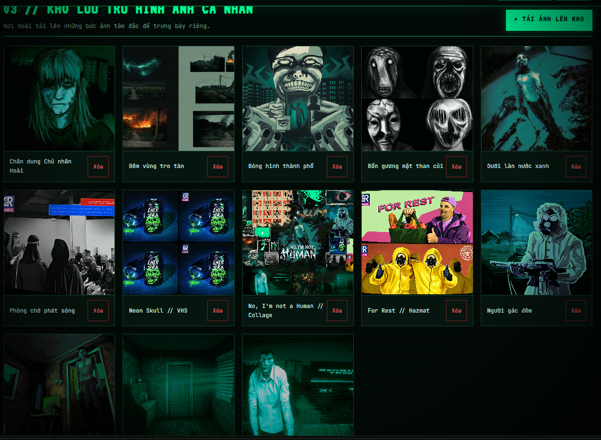
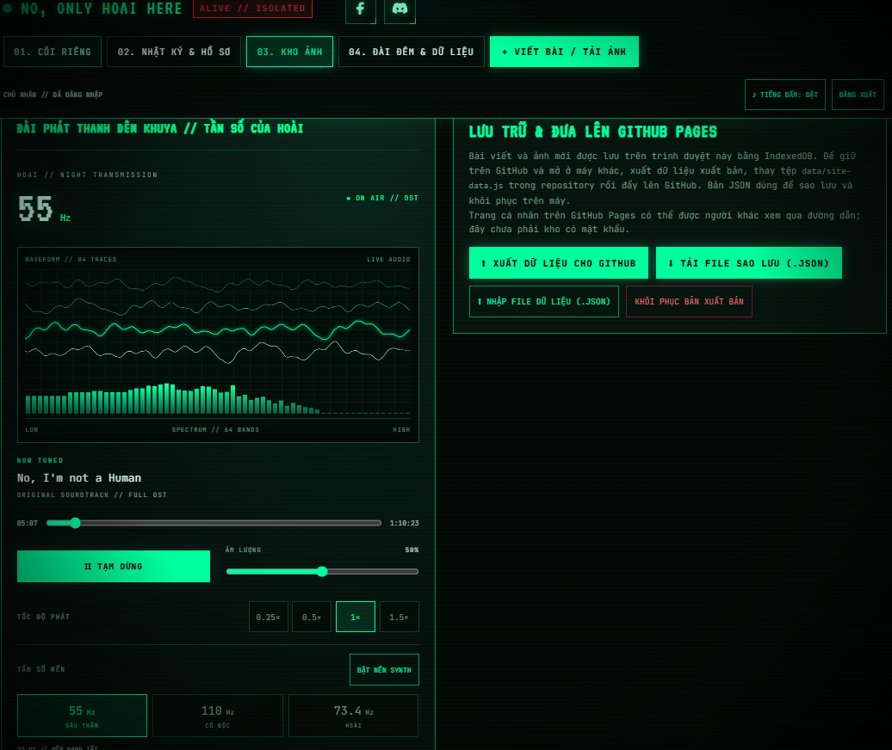

# NO, ONLY HOAI HERE

**Cõi riêng của Hoài — nhật ký, kho ảnh và đài phát thanh đêm khuya.**

[Mở website / Visit the site](https://hoaipahm.github.io/greenbew/)

Một website cá nhân mang phong cách kinh dị CRT/VHS: màn hình xanh lục bảo, vệt quét, ánh sáng nhiễu và âm thanh ma mị. Khách có thể đọc bài, khám phá kho ảnh và nghe đài; chỉ chủ nhân đăng nhập mới được chỉnh sửa nội dung.

**English:** Hoài’s personal sanctuary: a journal, image vault and late-night radio in an emerald CRT/VHS horror interface. Browse public posts and images, switch between Vietnamese and English, or listen to the soundtrack with live waveforms. Only the authenticated owner can edit.

### Có gì ở đây? / Features

- Giao diện **VI / EN**, tương thích điện thoại và máy tính.
- Nhật ký có tìm kiếm, lọc chuyên mục và chế độ đọc bài.
- Kho ảnh với xem ảnh lớn, nén ảnh tải lên và quản lý dành riêng cho chủ nhân.
- Đài nhạc: waveform, phổ âm, tua, âm lượng, tốc độ phát, nhạc lặp và synth nền.
- Giám sát đêm: bốn góc camera từ ảnh có sẵn, đổi camera thủ công/tự động, đồng hồ và nhật ký tín hiệu hư cấu, đồng bộ VI / EN.
- Chủ nhân sửa chú thích từng ảnh bằng hai ô Việt/Anh; khách chỉ xem.
- Supabase lưu bài và ảnh; Authentication, RLS và Storage policies kiểm soát quyền ghi.
- GitHub Pages phục vụ giao diện; HTML, CSS và JavaScript thuần, không cần build.

### Xem trước / Preview

Ảnh chụp từ phiên quản trị; khách không có các nút chỉnh sửa.

### Quyền riêng tư / Privacy

Bài đã xuất bản và ảnh trong bucket công khai có thể được mọi người xem và tải xuống. Không dùng kho này để lưu tài liệu riêng tư. Project URL, publishable key và UUID chủ nhân không phải mật khẩu; không đưa secret key, mật khẩu hoặc token quản trị lên repository. Quyền ghi phụ thuộc vào RLS/Storage policies trên Supabase, không chỉ các nút ẩn trong giao diện.

Artwork and soundtrack are third-party media used in this personal project; their rights remain with their respective owners. This repository does not grant a license to those assets.

## Ngôn ngữ giao diện

Nút **VI / EN** ở góc phải chuyển giao diện, nhãn bài và chú thích ảnh có sẵn giữa tiếng Việt và tiếng Anh, không tải lại trang hoặc ngắt nhạc. Lựa chọn được lưu trên trình duyệt. Nội dung và bản nháp không bị sửa khi chuyển ngôn ngữ. Bản dịch nằm trong `i18n.js`; ảnh có tên tùy chỉnh mới cần bổ sung bản dịch ở đây. Hai chú thích cũ trong snapshot được đổi thành **Buổi Tế Lễ / The Ritual** và **Tổ chức FEMA / FEMA Organization** khi tải dữ liệu.

Trang nhật ký, kho ảnh và đài âm nhạc cá nhân. Giao diện chạy trên GitHub Pages, backend mới dùng Supabase để mọi người xem và chỉ chủ nhân chỉnh sửa.

## Trạng thái

Đã cấu hình Supabase; chủ nhân đã xác nhận hoàn tất thiết lập và sử dụng được trên máy. Các bộ kiểm tra tự động dùng dữ liệu mô phỏng, không thay thế việc kiểm tra quyền trên project thật.

Hướng dẫn từng bước: [SUPABASE_SETUP.md](SUPABASE_SETUP.md). SQL tạo database, RLS, bucket và hàm lưu nằm trong [supabase/setup.sql](supabase/setup.sql); gán chủ nhân bằng [supabase/set-owner.sql](supabase/set-owner.sql).

## Chạy trên máy

    python serve.py

Mở http://127.0.0.1:8000/. Máy chủ hỗ trợ HTTP Range để tua MP3 lớn đúng đoạn.

Khi chưa kết nối Supabase, khách xem bài/ảnh có sẵn. Chỉ localhost có nút **SOẠN THẢO THỬ TRÊN MÁY**, dùng IndexedDB cũ. Xuất JSON trước khi chuyển trình duyệt, hostname hoặc cổng.

## Lưu trữ và quyền truy cập

Để sửa chú thích ảnh: đăng nhập chủ nhân → **Kho ảnh → SỬA** dưới ảnh → nhập cả bản Việt và Anh → **LƯU CHÚ THÍCH**. Mỗi bản tối đa 200 ký tự. Đổi VI / EN sẽ hiện bản tương ứng trong kho và cửa sổ ảnh lớn. Hủy không thay đổi dữ liệu; nếu lưu lỗi, văn bản được giữ trong hộp sửa.

Hai bản chú thích được đóng gói trong trường `title` có sẵn với tiền tố `@hoai-caption:`; ảnh cũ dùng chuỗi đơn vẫn được hỗ trợ. Không cần thay schema hay chạy lại SQL Supabase.

- Bài, bio, danh sách ảnh: bảng hoai_site trong Supabase; mỗi lần lưu là một snapshot nguyên tử có revision.
- Ảnh tải thêm: bucket hoai-images, không nhúng byte ảnh vào database.
- Chủ nhân: tài khoản email/mật khẩu tạo trong Supabase Authentication, UUID gán thủ công trong SQL và cấu hình.
- Khách: đọc bài/xem ảnh không cần đăng nhập; RLS và Storage policies chặn ghi.
- Bản nháp: chỉ trên máy, không công khai.
- Nhạc và ảnh có sẵn trong assets/: giữ trên GitHub.

Đăng nhập Firebase cũ không chuyển thành tài khoản Supabase. Không dùng UID Firebase làm ownerId Supabase.

Kho trên máy, tệp Firebase cũ và rules được giữ nguyên để khôi phục. index.html không tải Firebase nữa; firebase-config.js đã tắt. Không xóa project hoặc dữ liệu cũ trước khi kiểm tra chuyển thành công.

## Giới hạn của mã hiện tại

Tối đa 2.000 bài, 5.000 mục ảnh, 8 MiB JSON nội dung và 20 MiB mỗi ảnh đầu vào. Ảnh được nén trước khi tải lên. Đây là giới hạn bảo vệ của ứng dụng; hạn mức dịch vụ xem tại [Supabase Pricing](https://supabase.com/pricing).

JSON tải xuống từ bản online chứa URL ảnh, không thay thế bản sao lưu toàn bộ bucket. File ảnh không tự bị xóa khi bỏ khỏi gallery để tránh làm hỏng bài vẫn dùng ảnh đó.

## Đài và hiệu ứng

Giữ MP3, tua khi thả tay, tốc độ 0.25×/0.5×/1×/1.5×, âm lượng, 4 dải sóng và 64 cột phổ âm thật. Synth 55Hz/110Hz/73.4Hz dùng chung màn sóng. Tiếng bấm ma mị có công tắc bật/tắt riêng.

Trang thử tự phát MP3 khi mở và lặp lại khi hết. Nếu trình duyệt chặn nhạc có tiếng, nhạc bắt đầu sau lần bấm/chạm đầu tiên hoặc nút PHÁT NHẠC. Khi khách bấm TẠM DỪNG, các tương tác và việc chuyển tab không tự bật lại; có thể bấm PHÁT NHẠC để nghe tiếp.

## GitHub Pages

Đưa index.html, app.js, radio.js, access.js, ui-sounds.js, i18n.js, gallery-editor.js, surveillance.js, supabase-client.js, supabase-config.js, enhancements.css, assets/, data/ và .nojekyll lên repository.

Bật **Settings → Pages → Deploy from a branch → main → /(root)**. Không cần Firebase Hosting.

Repository: https://github.com/hoaipahm/greenbew — Website: https://hoaipahm.github.io/greenbew/.

Sau khi thay mã giao diện, commit và push lên `main` để Pages cập nhật. Bài/ảnh lưu qua website được cập nhật trên Supabase, không cần push lại. Muốn quay về bản mã trước, dùng `git revert` commit tương ứng và push; thao tác này không khôi phục dữ liệu Supabase.

Chỉ để Project URL và publishable/anon key trong cấu hình Web. Không đưa service_role, sb_secret_, access token hoặc mật khẩu database vào frontend/repository.

## Kiểm tra

    node --check app.js
    node --check supabase-client.js
    node tests/browser-check.cjs
    node --experimental-vm-modules tests/supabase-check.cjs
    python -m unittest discover -s tests -p test_serve.py

Browser checks dùng Microsoft Edge mặc định Windows, project cloud bị tắt bằng fixture để không chạm dữ liệu thật; Google Fonts cũng bị chặn. Supabase checks dùng SDK mô phỏng, không thực thi SQL/RLS trên dịch vụ thật. Cần kiểm tra project thật sau khi bạn cung cấp cấu hình và chạy SQL.

Bộ kiểm tra Firebase được giữ cho adapter cũ, không phải bằng chứng xác nhận Supabase.

Tài liệu: [Supabase RLS](https://supabase.com/docs/guides/database/postgres/row-level-security), [Supabase SDK](https://supabase.com/docs/reference/javascript/installing).
